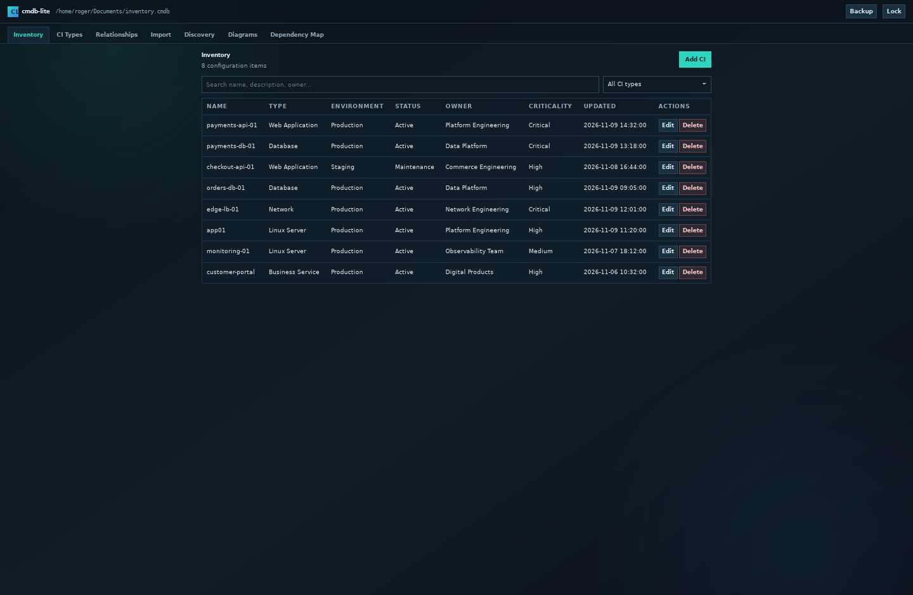
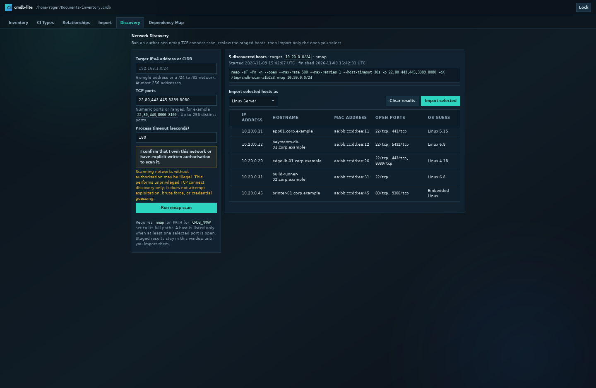
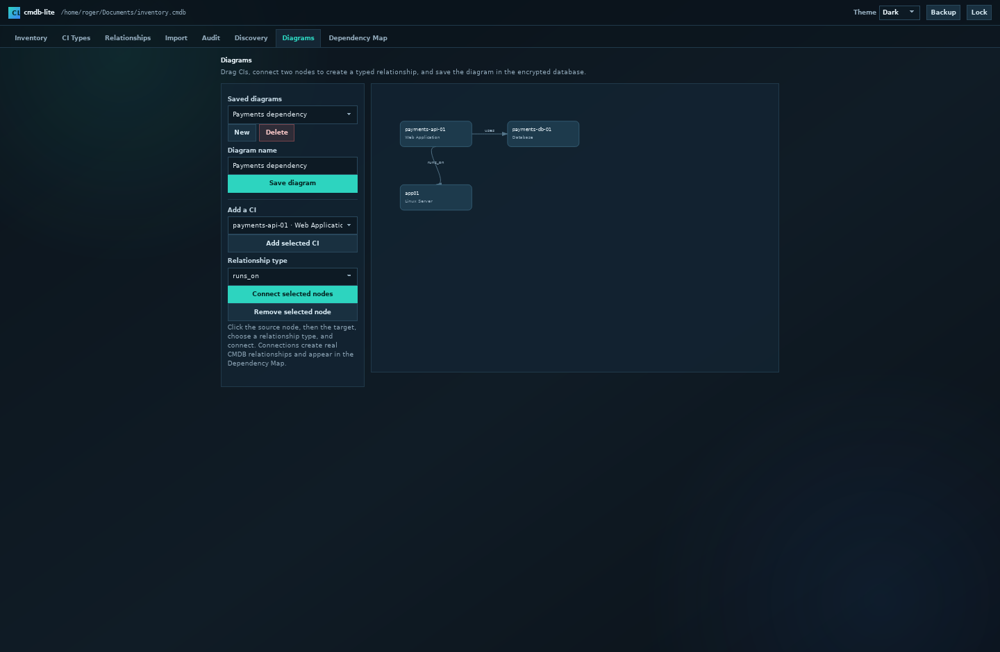
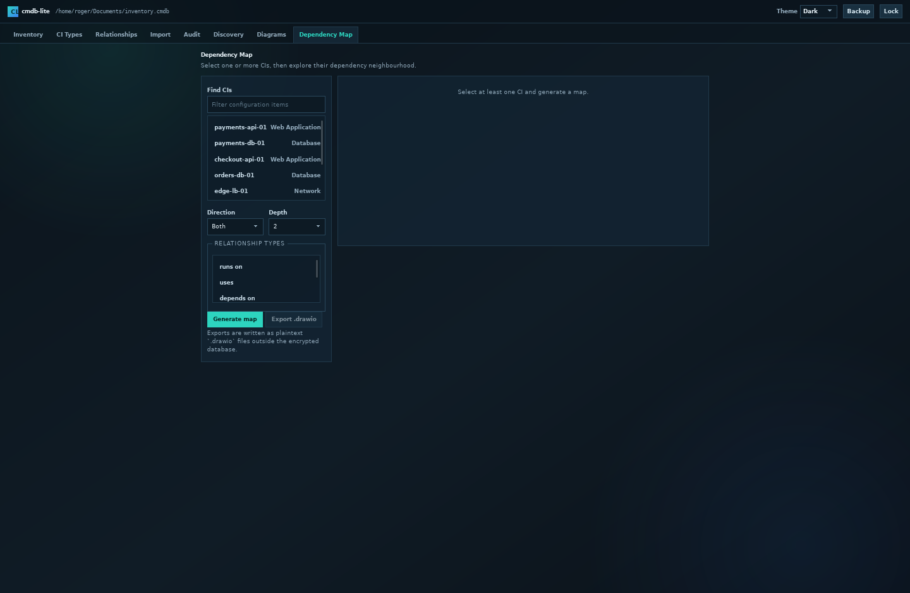
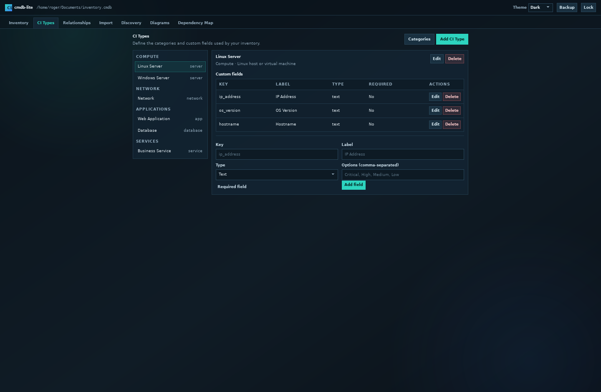
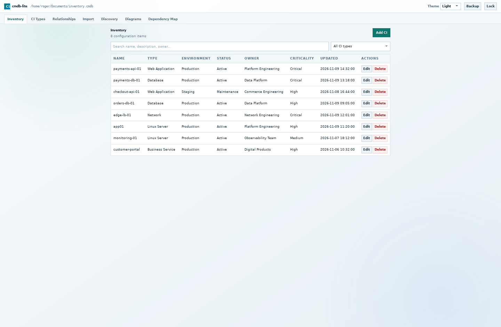
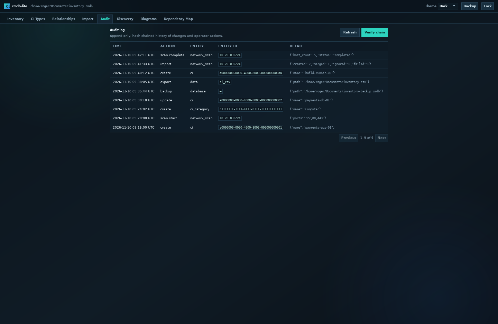
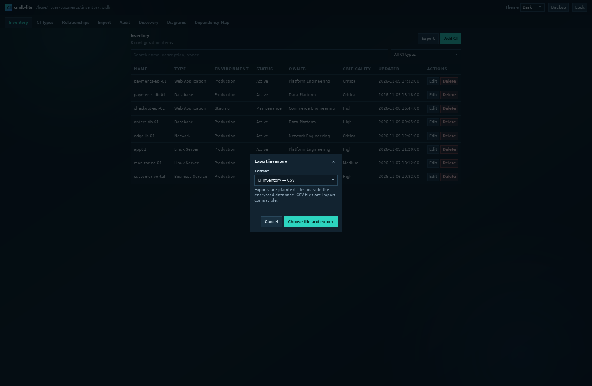
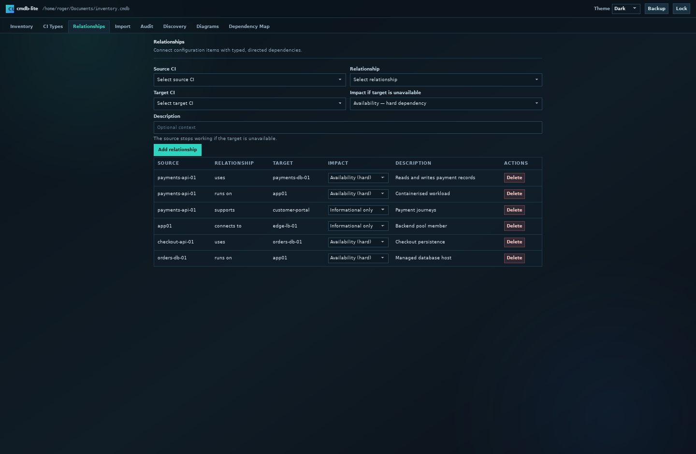
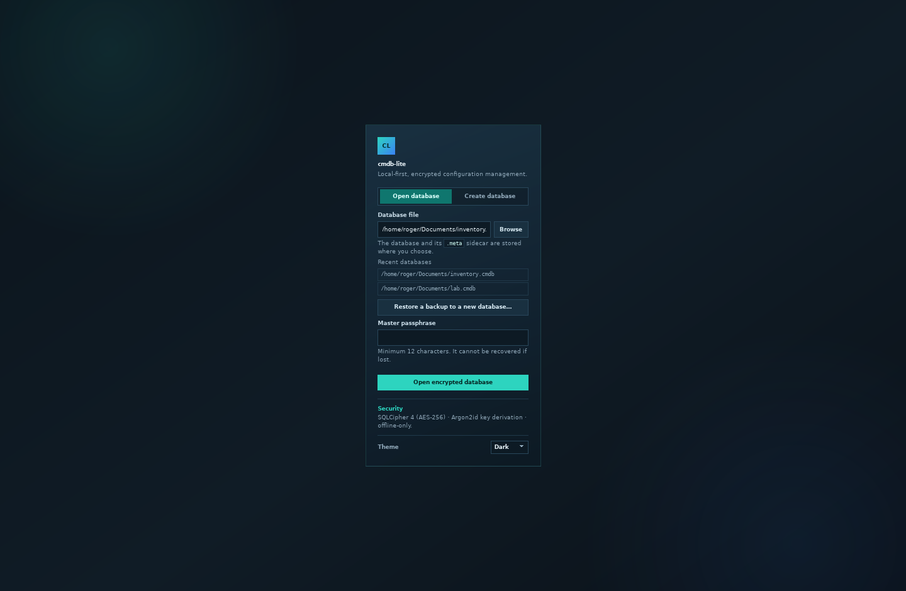

# cmdb-lite

A local-first, encrypted Configuration Management Database (CMDB) for Linux and
Windows.

> **Status: v0.7.0 development.** The repository contains the C17 core,
> SQLCipher storage layer, Argon2id key derivation, CI categories/types/custom
> fields, impact-aware typed relationships, seeded infrastructure services,
> CSV/TSV import, dependency graph builder, `.drawio` export, an embedded
> diagram editor, persisted nmap discovery with matching/merge review, encrypted
> database backup, the desktop webview shell, and the Go `cmdb-server` with
> first-run setup, password login, TOTP, recovery codes, sessions, and admin
> account management. Linux, Fedora, Windows, and Flatpak CI builds are defined;
> the Windows job runs a real WebView2 smoke test and produces the portable ZIP
> and MSI. A clean-Windows-VM install/uninstall check is still recommended.

> **Release status:** v0.6.0 is the latest published release. v0.7.0, which adds
> authenticated server mode and server-only packages, is not tagged for this
> rollout. Install from a verified local build/package, record the commit hash,
> and verify checksums. See [`docs/releasing.md`](docs/releasing.md) and
> [`docs/authentication.md`](docs/authentication.md).

> **Production use:** server mode is single-node and is not yet a turnkey
> appliance. Before exposing it to users, complete the server deployment
> checklist in [`docs/server.md`](docs/server.md): dedicated service account,
> root-only passphrase file, TLS at HAProxy/VPN, accurate time, backup/restore
> drill, and a tested break-glass procedure for the one-admin deployment.

## At a glance

- **Deployment:** one package with two Linux modes. `cmdb` is a desktop client
  for a local encrypted database or for connecting to a server. `cmdb-server`
  owns the database and adds multiple accounts, username/password login, TOTP,
  recovery codes, and per-user audit actors. It is a single-node server: one
  process, one database, no clustering/HA. Passkeys are out of scope for this
  phase. HIBP integration is out of scope for this rollout; the separate HIBP
  server, if used later, remains a separate security boundary.
- **Platforms built by CI:** Linux x86_64 (desktop+server `.deb`, RPM, portable
  tarball, server-only `.deb`/RPM/tarball, Flatpak) and Windows x86_64 (portable
  ZIP, MSI). The Windows package is a desktop client only.
- **Current limitation:** desktop-local mode has no application-level login
  beyond the database passphrase, and the desktop client does not start the
  server automatically. Server mode is Linux-only for now.
- **Not currently built:** macOS, ARM64, 32-bit, or a Windows server.
- **Storage:** one SQLCipher database plus a required `.meta` sidecar. Desktop
  local mode opens a user-selected file; server mode owns a server-side file.
- **Secrets:** the CMDB is not a password vault. Do not store passwords, API
  keys, tokens, or private keys in it; store references instead.
- **Network:** desktop-local mode is offline-first; its only network activity is
  an explicitly authorised nmap scan. Server mode listens on the configured
  loopback/private address and should be reached through HAProxy/VPN. There is
  no telemetry, cloud sync, or update check.
- **License:** MIT; third-party notices are in
  [`THIRD_PARTY_NOTICES.md`](THIRD_PARTY_NOTICES.md).

### Reference deployment profile (this rollout)

This repository is being prepared for one specific deployment:

| Decision | Choice |
|---|---|
| Modes | Desktop-local **and** one Linux server. |
| Accounts | **One user / one administrator**; additional accounts are possible but not planned. |
| Network | Server reachable only on a local private network; do not expose it directly to the internet. |
| Operating systems | Current Ubuntu and current Fedora for the server; Windows remains desktop-only. Validate the built package on the exact target image. |
| Backup / RPO | 24-hour RPO; a daily maintenance window may stop the service for a consistent stop/copy backup. |
| Authentication | Mandatory TOTP plus at least one unused recovery code; temporary passwords must be changed at first use. |
| One-admin recovery | Tested `cmdb-server --reset-auth` break-glass procedure; keep recovery codes and the database passphrase separately. |
| RBAC / SSO | Out of scope for this rollout; all accounts share inventory privileges. |
| HIBP | Out of scope for this rollout; the export code remains available but no HIBP integration will be deployed. |
| Release artifacts | Local verified packages; release tagging, signing, and SBOM generation are skipped by decision. |

The detailed runbook is in [`docs/server.md`](docs/server.md). The decisions
above are the reference profile; if the deployment changes, update this table
and the checklist before go-live.

### Version and build information

The desktop client shows its build identity on the unlock screen and in the top
bar after opening a database or connecting to a server. For example, a local
Debug build shows:

```text
v0.7.0 · build 1234 · commit abc123def456 · 2026-11-11T21:05:48Z · Linux/x86_64 · Debug
```

The server exposes the same information:

```bash
cmdb-server --version
```

It is also returned by `/api/v1/auth/status` and `/api/v1/auth/session`, so the
server UI shows the server build in its top bar.

Build metadata is generated when CMake configures the build:

- **version**: the semantic project version from `CMakeLists.txt`;
- **build number**: the CI run number (`GITHUB_RUN_NUMBER`) when present,
  otherwise the local git commit count;
- **commit**: short `HEAD` or CI `GITHUB_SHA`;
- **date**: UTC configure time;
- **target**: OS/architecture;
- **type**: `Debug`, `Release`, or `multi` for multi-config generators.

Override the inferred values when producing a controlled build:

```bash
cmake -S . -B build -G Ninja \
  -DCMDB_BUILD_NUMBER=1234 \
  -DCMDB_BUILD_COMMIT=9333922e6176
```

The build label is the reliable way to tell two packages with the same semantic
version apart.

## Screenshots

| Inventory | Network discovery |
|---|---|
|  |  |
| **Diagram editor** | **Dependency map** |
|  |  |
| **CI types and custom fields** | **Light theme** |
|  |  |
| **Audit log** | **HIBP export** |
|  |  |
| **Relationships and impact** | **Unlock / recent databases** |
|  |  |

The screenshots use sample inventory data.

## Installation

A Git clone contains source only; executables are not committed. Download the
latest release from:

<https://github.com/RogerBergling/cmdb-lite/releases/latest>

Release assets (the latest published release is v0.6.0; substitute the version
you download):

| Platform | Files |
|---|---|
| Debian/Ubuntu | `cmdb-lite_0.6.0_amd64.deb` |
| Fedora (RHEL untested) | `cmdb-lite-0.6.0-*.rpm` |
| Portable Linux | `cmdb-lite-0.6.0-linux-x86_64.tar.gz` |
| Flatpak (Linux) | `cmdb-lite.flatpak` |
| Windows portable | `cmdb-lite-windows-x64.zip` |
| Windows installer | `cmdb-lite-0.6.0-windows-x64.msi` |
| Server-only DEB (v0.7.0+) | `cmdb-lite-server_0.7.0_amd64.deb` |
| Server-only RPM (v0.7.0+) | `cmdb-lite-server-0.7.0-*.rpm` |
| Server-only tarball (v0.7.0+) | `cmdb-lite-server-0.7.0-linux-x86_64.tar.gz` |
| Checksums | `SHA256SUMS` |

Verify the download before running it:

```bash
sha256sum -c SHA256SUMS
```

On Windows:

```powershell
Get-FileHash .\cmdb-lite-windows-x64.zip -Algorithm SHA256
```

Compare the output with the matching line in `SHA256SUMS`.

### Flatpak (recommended for a self-contained Linux install)

The Flatpak uses the GNOME runtime for GTK3/WebKitGTK and bundles SQLCipher,
libsodium, nmap, and the application. It runs on Fedora, Debian, Ubuntu, and
other Flatpak hosts without installing development packages. The GNOME runtime
must be installed (Flatpak fetches it from Flathub if needed).

```bash
flatpak install --user ./cmdb-lite.flatpak
flatpak run io.github.rogerbergling.CmdbLite
```

The sandbox permits network access for authorised scans and home-directory
access so you can choose a database file. OS detection (`nmap -O`) still needs
root privileges and is unavailable in the standard Flatpak sandbox; service
detection (`-sV`) works normally. See [`docs/flatpak.md`](docs/flatpak.md).

### Debian / Ubuntu

Install the dependencies first, then the package:

```bash
sudo apt update
sudo apt install -y libgtk-3-0t64 libwebkit2gtk-4.1-0 libssl3t64
sudo apt install ./cmdb-lite_0.6.0_amd64.deb
cmdb
```

The `.deb` declares its runtime dependencies. SQLCipher and libsodium are
linked statically when the build environment provides their `.a` archives;
expat, GTK3, WebKitGTK, and OpenSSL remain system libraries. The published
`.deb` targets Ubuntu 24.04 and newer; for Debian 12 or Ubuntu 22.04, use the
Flatpak or build from source. The Flatpak is the fully self-contained option.

### Fedora / RHEL

Install with `dnf` so dependencies are resolved automatically:

```bash
sudo dnf install ./cmdb-lite-0.6.0-*.rpm
cmdb
```

Manual dependency installation is normally unnecessary. The RPM requires GTK3,
WebKitGTK 4.1, expat, and the system OpenSSL libraries. It is built on current
Fedora; RHEL compatibility is not tested. Build from source on RHEL if the RPM
does not install.

### Windows

**Portable ZIP**

1. Unzip `cmdb-lite-windows-x64.zip`.
2. Run `bin\cmdb.exe`.
3. If Windows reports a missing WebView2 runtime, install the Microsoft
   Edge WebView2 Evergreen Runtime. It is present on current Windows 10/11.

No DLLs, `web/` folder, or additional runtime files are required. SQLCipher,
libsodium, OpenSSL, expat, and the C/C++ runtime are linked statically. Windows
artifacts are unsigned by the current rollout decision and may trigger a
SmartScreen warning.

**MSI installer**

```powershell
msiexec /i .\cmdb-lite-0.6.0-windows-x64.msi
```

The MSI is per-machine, requires administrator elevation, and creates a Start
Menu shortcut. Uninstall with:

```powershell
msiexec /x .\cmdb-lite-0.6.0-windows-x64.msi
```

### Portable Linux tarball

```bash
tar -xzf cmdb-lite-0.6.0-linux-x86_64.tar.gz
./cmdb-lite-0.6.0-linux-x86_64/bin/cmdb
```

The ELF requires GTK3, WebKitGTK 4.1, expat, and the system OpenSSL 3
`libcrypto.so.3`. SQLCipher and libsodium are linked statically when the build
environment provides their `.a` archives. The released tarball is built on
Ubuntu 24.04 and is not guaranteed to run on older glibc distributions.

### First launch

1. Choose **Create database**.
2. Select a path for the encrypted `.cmdb` file. A `.cmdb.meta` sidecar is
   created next to it.
3. Enter a master passphrase of at least 12 characters.
4. Use **Backup** in the top bar to create a consistent encrypted copy. The
   `.cmdb` and `.cmdb.meta` files must be kept together. The passphrase cannot be
   recovered.

The application never uploads data. The database remains at the path you chose.
See [`docs/backup.md`](docs/backup.md) for backup and restore details.

### Server mode

The Linux package also installs `cmdb-server` and the `cmdb-rpc` bridge. The
server owns the database; users log in with their own accounts and never receive
the database passphrase.

```bash
# Interactive first validation: the server prompts for the passphrase.
cmdb-server --db /var/lib/cmdb-lite/inventory.cmdb --listen 127.0.0.1:8080
```

For a non-interactive service, put `CMDB_DB_PASSPHRASE` in a root-owned
environment file read by systemd; do not put it in shell history or a command
line.

On first start the server prints a one-time setup token. Open
`http://127.0.0.1:8080/login`, enter the token, and create the first
administrator. The token expires after 24 hours; while no users exist, restarting
the server prints a new one. TOTP enrollment and at least one unused recovery
code are mandatory before inventory access; the Security page guides this. After
setup, create additional accounts from the **Users** page if needed.

To use the desktop client against a server instead of opening a local file,
choose **Connect to server** on the unlock screen, enter the server URL, and
press **Connect to server**. The URL is remembered in local storage. The
equivalent non-interactive launch is:

```bash
CMDB_SERVER_URL=https://cmdb.example.internal cmdb
```

The native client unbinds the local database bridge before loading the remote
page, so the server UI cannot call into the local C core.

The client does not start the server automatically. Server sessions default to
12 hours absolute and 30 minutes idle; change them with `--session-idle` and
`--session-absolute`. The service has no TLS listener: terminate TLS at
HAProxy/VPN, bind to loopback or a private address, and add the proxy CIDR to
`--proxy`.

Authentication state lives inside the encrypted database under `app_meta`, so a
normal database backup includes accounts and MFA material. The server has no
backup API yet: stop it before copying the `.cmdb` and `.meta` files. Sessions are
memory-only and are lost on restart. Opening a server-managed database in local
desktop mode bypasses application logins. See
[`docs/authentication.md`](docs/authentication.md) for the full design and
[`docs/backup.md`](docs/backup.md) for backup implications.

### Data locations

| Data | Location | Contains secrets? |
|---|---|---|
| Inventory database | The `.cmdb` path you choose | Encrypted inventory, diagrams, audit log. The passphrase is never stored. |
| KDF sidecar | `<database>.cmdb.meta` next to the database | Salt and KDF parameters only; required to open the database. |
| Recent-database settings (desktop-local) | Linux: `$XDG_CONFIG_HOME/cmdb-lite/config.json` (normally `~/.config/cmdb-lite/config.json`). Windows: `%APPDATA%\cmdb-lite\config.json` | Database paths only; no passphrase or key. |
| Server database | Operator path, typically `/var/lib/cmdb-lite/inventory.cmdb` | Encrypted inventory, audit log, and `auth.state` (accounts, Argon2id hashes, TOTP secrets, recovery-code hashes). |
| Server web assets | `/usr/share/cmdb-lite/web/` | `index.html`, `app.js`, `style.css`; must match the server version. |
| Server passphrase file | Operator-managed, typically `/etc/cmdb-lite/server.env` | Contains `CMDB_DB_PASSPHRASE`; root-owned, mode `0600`, read by systemd. |
| Server sessions | Server process memory only | Session and CSRF tokens. Lost on restart. |
| Server logs | systemd journal or process stdout/stderr | Startup, first-run setup token, database-open result, audit write failures. Restrict journal access. |
| Backups | Desktop: the path you choose in **Backup**. Server: operator copy while stopped. | An encrypted `.cmdb` plus matching `.meta` sidecar. Server backups include `auth.state`. |
| Exports, `.drawio`, HIBP CSV | The path you choose | Plaintext. Store and delete according to your data-handling policy. |
| Scan XML | Private temporary file (`0600` on POSIX), deleted after parsing | Discovery results before they enter encrypted staging. |
| Application logs | Desktop: none by default. Server: systemd journal. | Server logs include startup, setup-token, and database-open lines; authentication and inventory events are in the encrypted audit table. |

Do not put the database or its sidecar in a world-writable directory. On
Windows, use a per-user folder; the POSIX `0600` protection does not apply.

### Environment variables

| Variable | Applies to | Purpose |
|---|---|---|
| `CMDB_DB_PASSPHRASE` | `cmdb-server` | Database passphrase for non-interactive start. The server unsets it after reading. Prefer a root-only environment file/systemd `EnvironmentFile`, never a command line or shell history. |
| `CMDB_SERVER_URL` | desktop `cmdb` | Non-interactive alternative to **Connect to server**. Use HTTPS for anything except loopback. |
| `CMDB_NMAP` | scanner | Full path to `nmap`/`nmap.exe` when it is not on `PATH`. |
| `CMDB_CONFIG_DIR` | desktop-local | Override the per-user config directory used for recent database paths. |
| `CMDB_WEB_DIR` | Debug desktop; server | Debug desktop: load `src/web` instead of the embedded UI. Server: override the installed web asset directory. |
| `CMDB_UI_URL` | Debug desktop | Load a custom UI URL. Compiled out of release desktop builds with `NDEBUG`. |
| `CMDB_DEVTOOLS` | Debug desktop | Enable webview developer tools when set to `1`. |
| `CMDB_SMOKE_TEST`, `CMDB_SMOKE_DB`, `CMDB_SMOKE_RESULT` | CI/dev desktop | Automated WebView2/WebKit smoke test. Not for production. |

### Backup, restore, and upgrade

- Use **Backup** to create a consistent encrypted backup while the database is
  open. The backup is a `.cmdb` plus matching `.meta` sidecar; keep them together.
- **Restore a backup to a new database…** is available on the unlock screen. It
  refuses to overwrite an existing database.
- Before a schema migration, the application creates an automatic backup next to
  the database and reports its path. If the backup cannot be created, the
  migration is refused.
- After a migration, do not open the database with an older application. Restore
  both files from the pre-upgrade backup to roll back.
- There is no passphrase recovery. A lost passphrase means the data is lost.

**Not yet implemented:** configurable automatic and scheduled backups. The
production rollout requires manual, automatic, and scheduled modes with
destination/interval/retention settings. The current release has manual backup
plus the automatic pre-migration backup only. See [`docs/backup.md`](docs/backup.md).

Full procedures: [`docs/backup.md`](docs/backup.md) and
[`docs/upgrading.md`](docs/upgrading.md).

### Network discovery prerequisite

Network discovery invokes an installed nmap executable:

```bash
# Debian/Ubuntu
sudo apt install nmap

# Fedora
sudo dnf install nmap
```

On Windows, install nmap from <https://nmap.org/download.html> and put
`nmap.exe` on `PATH`. If it is installed elsewhere, set `CMDB_NMAP` to the full
path before starting the application. The Flatpak bundles nmap.

`-sV` service/version detection works unprivileged. `-O` OS detection requires
root on Linux or an elevated process on Windows, and is unavailable in the
standard Flatpak sandbox. See
[`docs/scanning.md`](docs/scanning.md) for the safety model, exact command,
persisted staging, matching/merge review, cancellation, and troubleshooting.

### Upgrading

Application upgrades replace the executable only. Your database and `.meta`
sidecar stay where they are. The application remembers the last database and
shows recent databases on the unlock screen.

v0.7.0 does not change the database schema. It adds the Go `cmdb-server`,
`cmdb-rpc`, and optional authenticated server mode. Existing databases open
normally and keep the same passphrase. Server accounts are stored inside the
same encrypted database under `app_meta`; a normal backup includes them. The
desktop client remains local unless `CMDB_SERVER_URL` is set.

v0.6.0 migrated the database from schema version 3 to version 4. It added
relationship impact classes, new management/monitoring/provider relationship
types, and the seeded `Service` CI type. If you are upgrading from v0.5.0 or
earlier, review existing `supports`, `connects_to`, and `member_of`
relationships after the upgrade; they default to `informational` and should be
changed if they represent real runtime dependencies. The automatic pre-upgrade
backup is created first and its path is shown after opening.

```bash
# Debian/Ubuntu
sudo apt install ./cmdb-lite_0.7.0_amd64.deb

# Fedora
sudo dnf upgrade ./cmdb-lite-0.7.0-*.rpm
```

On Windows, install the new MSI or replace the portable executable and open the
same database.

Full backup, rollback, and post-upgrade checks:
[`docs/upgrading.md`](docs/upgrading.md).

Or build locally with `./setup.sh` (Debian/Ubuntu), `./setup-fedora.sh`
(Fedora), or `setup-windows.ps1` (Windows).

## Why this exists

Most CMDB products are server applications. `cmdb-lite` is desktop-first: it
keeps the inventory in one encrypted database file that you choose and control,
and it can also run as a self-hosted authenticated server for a small team. The
desktop-local mode is offline-first; server mode is self-hosted and still has no
cloud dependency or telemetry.

The intended data is ordinary CMDB data — servers, IP addresses, serial numbers,
operating systems, owners, business services, applications, network devices,
virtual machines, and the relationships between them. Passwords, API keys, and
other secrets **must not** be stored in the CMDB; store a reference to your
password vault instead.

## Features

### Implemented

- Desktop webview shell for Linux (GTK3 + WebKitGTK 4.1) and Windows
  (WebView2), with one shared C17 core and one shared HTML/CSS/JS user
  interface.
- **Authenticated server mode** for Linux: Go `cmdb-server`, C `cmdb-rpc`, a
  first-run setup token, Argon2id passwords, mandatory TOTP and recovery codes,
  forced temporary-password changes, CSRF-protected sessions, admin account
  management, and per-user audit actors.
- Encrypted SQLCipher database at a user-selected path in desktop-local mode;
  server mode keeps the database behind the server.
- Master passphrase with Argon2id key derivation (libsodium).
- Sidecar key-derivation metadata file with an integrity checksum.
- Managed CI categories with stable IDs, ordering, colors, and CI type
  assignment.
- User-defined CI types and per-type custom fields.
- Dark, light, and follow-system themes with persisted preference.
- CI records with the standard CMDB fields listed below.
- Typed relationships with duplicate and self-reference protection.
- **Impact-aware relationships**: availability, degraded, management,
  monitoring, and informational, with per-type defaults and per-connection
  overrides. See [`docs/dependencies.md`](docs/dependencies.md).
- **Service CIs** for DNS, SMTP, NTP, DHCP, LDAP/AD, vCenter, monitoring, and
  backup functions, linked to the servers or routers that provide them.
- CSV and TSV import with validation preview and transactional commit.
- Relationship import from CSV/TSV.
- Multi-seed dependency traversal with direction and depth controls.
- Dependency map rendered in the UI.
- `.drawio` export generated from the dependency graph.
- **Embedded diagram editor** with draggable CIs, persistent diagrams stored as
  `.drawio` XML inside the encrypted database, and connections that create real
  typed relationships.
- **nmap-based network discovery** with an authorisation gate, `/24` scope limit,
  fixed argv, private XML output, optional `-sV` service detection, optional
  `-O` OS detection (privileged), cancellation, and an overall timeout.
- **Persisted scan staging** with exact-match suggestions against existing CIs
  by IP, MAC, hostname, and CI name. The operator chooses create, merge (fill
  empty fields or overwrite scan fields), or ignore for each host.
- **Encrypted database backup** from the application; the backup is consistent
  while the database is open and includes the matching `.meta` sidecar.
- **Restore to a new database path** from the unlock screen.
- **Automatic pre-migration backup** before a schema upgrade, with the backup
  path shown after opening.
- **Last database and recent database list**, stored in a per-user config file
  without the passphrase.
- **CSV/JSON export** for CI inventory, relationships, a full snapshot, and a
  **HIBP Linux host feed** with `cmdb_ci_id` links and no secrets.
- **Audit log viewer** with hash-chain verification.
- Append-only audit log with a hash chain.
- **Desktop executables embed the UI**: a Linux ELF and a Windows EXE contain the
  HTML/CSS/JS bundle. The Linux server package additionally ships
  `cmdb-server`, `cmdb-rpc`, and `share/cmdb-lite/web`.
- Linux `.deb`/RPM/TGZ (desktop and server), a **Flatpak using the GNOME runtime
  and bundling nmap** (desktop only), and Windows portable ZIP plus
  WiX-generated MSI (desktop only, able to connect to a Linux server).
- Core test suite, including a live nmap test in Linux/Fedora CI, parser
  fixtures, asynchronous scan-manager cancellation, backup, export, impact, and
  graph tests. Schema migration is exercised manually against the previous
  release before tagging.
- MIT license.

### Distribution model

The desktop application embeds its UI. Linux server packages ship separate
binaries and web assets because the server serves the UI over HTTP:

| Platform | Artifact | Contents and runtime requirements |
|---|---|---|
| Windows | `cmdb.exe` | Desktop only. Embedded UI. WebView2 runtime (present on current Windows 10/11). SQLCipher, libsodium, OpenSSL, expat, and the C/C++ runtime are linked statically. Use `CMDB_SERVER_URL` to connect to a Linux server over HTTPS. |
| Linux (.deb/RPM/TGZ) | `cmdb`, `cmdb-server`, `cmdb-rpc`, `share/cmdb-lite/web/`, systemd unit | Desktop plus single-node server. The desktop needs GTK3, WebKitGTK 4.1, expat, and system OpenSSL. SQLCipher and libsodium are linked statically when `.a` archives are available. Server-only packages omit `cmdb` and GTK/WebKit. |
| Linux (Flatpak) | `cmdb-lite.flatpak` | Desktop only. Uses the GNOME runtime for GTK3/WebKitGTK and bundles SQLCipher, libsodium, and nmap. The GNOME runtime is installed separately by Flatpak. |

The encrypted database and its `.meta` sidecar are intentionally separate files.
In desktop-local mode the user chooses the path. In server mode the server owns
a path such as `/var/lib/cmdb-lite/inventory.cmdb`; users never receive the
passphrase. In **Debug builds only**, `CMDB_WEB_DIR=src/web` can load the
external UI files instead of the embedded bundle; release desktop builds always
use the embedded UI. Set `CMDB_STATIC_CRYPTO=OFF` to link SQLCipher/libsodium
dynamically on Linux.

CI builds on Ubuntu 24.04, a current Fedora container, the GNOME 48 Flatpak
runtime, and Windows Server 2022. That is build coverage, not a formal support
matrix. The Linux ELF requires GTK3, WebKitGTK 4.1, expat, and OpenSSL 3; the
Windows build requires the WebView2 Evergreen Runtime.

The `.deb` is built on Ubuntu 24.04 and therefore depends on the `t64` package
names and glibc 2.38 (`libgtk-3-0t64`, `libssl3t64`, `libglib2.0-0t64`). It is
not a Debian 12 or Ubuntu 22.04 artifact. The RPM is built on current Fedora;
RHEL compatibility is not tested. Use the Flatpak or build from source for older
or different distributions. Validate on the exact OS versions and desktop
environments you intend to support.

### Next milestones

- Server: flags/config file beyond the packaged systemd unit, health/readiness
  endpoint, graceful shutdown, online backup/restore, browser export/download,
  role-change UI, active-session management, and server HTTP integration tests.
- Windows server support and a one-click local-server launcher for the desktop
  client.
- Role-based access control and per-CI permissions.
- Passphrase rotation/rekey and automatic or scheduled encrypted backups with
  retention.
- Auto-lock/idle timeout and a single-instance database guard.
- Audit-log export and optional off-device forwarding.
- Pin the vcpkg baseline and GitHub Actions SHAs; add dependency scanning,
  CodeQL/cppcheck, ASan/UBSan, CSV/nmap fuzzing, and a Linux GUI smoke test to
  CI. Signing and SBOM generation are **not required** for the current rollout;
  `SHA256SUMS` is the published integrity check.
- Optional official draw.io web editor bundle (the current editor uses
  `.drawio`-compatible XML and the built-in canvas).

## CI record fields

Every CI has the following fields. `CI ID` and `Last Updated` are system-managed;
the rest are editable.

| Field | Required | Notes |
|---|---|---|
| CI ID | system | UUID generated by the application; stable for the life of the record. |
| CI Name | yes | Human-readable name, for example `app01` or `Payments API`. |
| CI Type | yes | Must reference a user-defined CI type. |
| Description | no | Free text, up to 4 KiB. |
| Environment | no | Examples: Production, Staging, Test, Development. |
| Status | no | Examples: Active, Planned, Maintenance, Retired. |
| Business Service | no | The service this CI supports. |
| Technical Owner | no | Person or team accountable for the technical component. |
| Support Team | no | Team that operates/supports the CI. |
| Criticality | no | Examples: Critical, High, Medium, Low. |
| Hosting / Location | no | Data centre, cloud region, rack, office, or site. |
| Dependencies | derived | Computed from typed relationships; never stored as free text. |
| Last Updated | system | UTC timestamp, updated whenever the record changes. |
| External ID | optional | Stable identifier from another system; used for idempotent imports. |
| Custom fields | optional | Defined per CI type; stored as key/value attributes. |

The UI treats Environment, Status, and Criticality as free text with suggested
values. This avoids hard-coding an organisation's taxonomy. A future version can
promote them to configurable lookup lists.

### CI types

CI types are user-defined and grouped into managed categories such as Compute,
Network, Applications, Services, or categories you create in the **Categories**
dialog. The application seeds editable examples:

- Linux Server, Windows Server, Virtual Machine
- Router, Switch, Firewall, Network
- Web Application, Database, Business Service, Cloud Service
- Service (DNS, SMTP, NTP, DHCP, LDAP/AD, vCenter, monitoring, backup, other)
- Other

Each type can define custom fields with a key, label, data type (`text`,
`number`, `date`, `boolean`, `url`, `select`), required flag, and select options.
The seeded types include useful fields such as `ip_address`, `serial_number`,
`os_version`, `vendor`, `model`, `url`, and `version`.

## Relationship model

Relationships are directed, typed edges between two CIs:

```text
Application --runs_on--> Server
Application --uses-----> Database
Server      --hosted_in-> Cloud
Application --supports-> Business Service
Server      --depends_on-> Network
```

Seeded relationship types:

| Type | Meaning | Inverse | Default impact |
|---|---|---|---|
| `runs_on` | Application or service runs on a host. | `hosts` | `availability` |
| `uses` | Component uses another component. | `used_by` | `availability` |
| `hosted_in` | CI is hosted in a location or platform. | `hosts` | `availability` |
| `supports` | CI supports a business service. | `supported_by` | `informational` |
| `depends_on` | CI depends on another CI. | `depended_on_by` | `availability` |
| `connects_to` | Network or physical connection. | `connects_to` | `informational` |
| `member_of` | CI is a member of a group/service. | `contains` | `informational` |
| `manages` | Management/control-plane relationship. | `managed_by` | `management` |
| `monitors` | Observability relationship. | `monitored_by` | `monitoring` |
| `provided_by` | Service is provided by a resource. | `provides` | `availability` |

Each relationship also has an **impact class**:

- `availability` — target down means source down;
- `degraded` — source continues with reduced function;
- `management` — vCenter-style control plane only;
- `monitoring` — observability only;
- `informational` — documentation or association only.

The type provides a default, but the operator can change the impact per
connection. The Dependency Map can filter by relationship type and impact class;
the default impact view includes only `availability` and `degraded`. See
[`docs/dependencies.md`](docs/dependencies.md) for the vCenter and DNS examples.

The dependency map can traverse outgoing, incoming, or both directions, up to
five levels deep, and can be filtered by relationship type. Cycles are handled
safely. Selecting multiple CIs produces the union of their dependency
neighbourhoods.

### HIBP integration (not part of this rollout)

HIBP integration is **out of scope for this deployment**. The export remains in
the application for future use, but no HIBP server or importer will be deployed
for this rollout. The notes below document the existing export only.

`cmdb-lite` can export Linux CIs as a HIBP-compatible CSV feed with a stable
`cmdb_ci_id`, OS data, tags, and no secrets. In a future rollout, HIBP would be
the separate privileged patch-management server. It provides account login with
a password plus TOTP and/or passkeys, owns its own encrypted database and SSH
credentials, and starts with Debian and Fedora server support.

`cmdb-lite` can be used desktop-local or with its optional authenticated server
mode; HIBP remains a separate security boundary with its own accounts, database,
passphrase, and SSH credentials. The future flow would be one-way inventory
onboarding: add the host once in `cmdb-lite`, export the HIBP CSV, import it into
HIBP, then complete SSH/host-key setup once in HIBP. HIBP patch facts could be
written back later. Do not share the encrypted databases or passphrases between
the two applications if that integration is enabled later. See
[`docs/hibp.md`](docs/hibp.md) for current importer limitations and the
onboarding flow.

### Authentication and server mode

The Linux package provides a Go `cmdb-server` and the C `cmdb-rpc` bridge:

- the server owns the encrypted database and keeps the database passphrase;
- browser and desktop clients authenticate with their own accounts;
- the desktop `cmdb` client opens a local database directly, or connects to a
  server when `CMDB_SERVER_URL` is set;
- several accounts share inventory privileges; administrators manage accounts
  and credential resets;
- username/password login, TOTP, and ten one-time recovery codes per user;
  passkeys are out of scope for this phase;
- sessions default to 12 hours absolute and 30 minutes idle and are configurable
  at server start;
- login, logout, MFA, recovery, user-management, and inventory changes are
  audited with the account name as actor;
- first-run admin creation is protected by a one-time setup token printed by the
  server.

Authentication state is JSON in `app_meta`; schema v4 is unchanged. Sessions are
memory-only. The desktop client does not start the server automatically, and
Windows server support is future work. See
[`docs/authentication.md`](docs/authentication.md) for architecture, flags,
storage, and API, and [`docs/server.md`](docs/server.md) for the deployment runbook.

### Server production notes

A Linux package installs `cmdb`, `cmdb-server`, `cmdb-rpc`, and
`share/cmdb-lite/web`. All four must come from the same release. The server
auto-detects the bridge and web assets; use `--rpc`/`--web-dir` only when they
are in non-standard locations.

Before go-live:

- Run it as a dedicated unprivileged user with `UMask=0077` and a `0700` state
  directory.
- Put the database passphrase in a root-owned environment file. Do not put it on
  a command line or in shell history.
- Terminate TLS at HAProxy/VPN; never expose the HTTP listener. Set
  `X-Forwarded-Proto: https` and append `X-Forwarded-For` at the proxy, and put
  the proxy address/CIDR in `--proxy`.
- Synchronize system time. TOTP accepts only one 30-second step of skew.
- With the one-admin decision, test the `--reset-auth` break-glass procedure in
  [`docs/server.md`](docs/server.md) on a copy. It requires the database
  passphrase and clears all accounts/TOTP/recovery state. The Users page can
  create additional administrators later if needed.
- Enroll TOTP and generate recovery codes for every account. The server forces
  both before inventory access; changing either requires the current password.
- Stop the server before copying the database pair. There is no online backup
  API, and the user-facing Backup action is hidden in server mode.
- Plan for sessions to be lost on every restart.

| Area | Current server behavior | Go-live implication |
|---|---|---|
| Availability | One process, one database, no clustering/HA | Plan a maintenance window for restarts and backups. |
| Concurrency | All API requests are serialized | A long import, scan operation, or audit verification blocks other users. |
| Backup | Offline copy only; no online API | Stop the service, copy `.cmdb` + `.meta`, restart. Test restore. |
| Export | Export/save operations are blocked in server mode | There is currently no browser download of inventory or `.drawio` files. |
| Accounts | First admin + admin-created users, including additional admins; no delete/role change UI | No user deletion or admin demotion after creation. |
| MFA | TOTP and at least one unused recovery code are required before inventory access | Enroll during first login; the server blocks inventory until both are present. |
| Passwords | Admin-created/reset passwords are temporary and force a change | The administrator knows the temporary password; the user must replace it before inventory access. |
| Sessions | Memory-only; no session list or global revoke UI | Restart logs everyone out; disable/reset actions revoke per user. |
| Authorization | Admin flag only; all other accounts share inventory privileges | No RBAC or per-CI permissions. |
| Operations | systemd unit packaged; no health endpoint, metrics, or request log | Enable the packaged unit and use a TCP check in [`docs/server.md`](docs/server.md); add monitoring. |
| Ingress | No TLS listener; proxy trust is CIDR-based | HAProxy/VPN is mandatory; configure forwarded headers or cookies/rate limits break. |

See [`docs/server.md`](docs/server.md) for a sample systemd unit, HAProxy
configuration, file permissions, backup/restore, upgrade/rollback, NTP, logs,
and hardening checklist.

### Install the server-only package

The v0.7.0 release adds a server-only Linux package that does not install the
desktop client or GTK/WebKit. It installs `cmdb-server`, `cmdb-rpc`, the web
assets, a systemd unit, documentation, and a sample environment file.

```bash
# Debian/Ubuntu
sudo apt install ./cmdb-lite-server_0.7.0_amd64.deb

# Fedora
sudo dnf install ./cmdb-lite-server-0.7.0-*.rpm

# Create the root-only passphrase file from the example, then edit it.
sudo install -d -o root -g root -m 0700 /etc/cmdb-lite
sudo install -o root -g root -m 0600 \
  /usr/share/doc/cmdb-lite/server.env.example /etc/cmdb-lite/server.env
sudo editor /etc/cmdb-lite/server.env

sudo systemctl enable --now cmdb-server
sudo journalctl -u cmdb-server -n 20 --no-pager
```

The package's post-install script creates the `cmdb` service user and
`/var/lib/cmdb-lite` with mode `0700`. It does not start the service or create
the passphrase file automatically. The first start prints the one-time setup
token to the journal. Read it, then open `https://your-host/login` through your
TLS proxy.

Install either the desktop+server package or the server-only package on a host,
not both: they share `cmdb-server`, `cmdb-rpc`, web assets, and the systemd unit.
The server-only package intentionally has no online backup/export feature and no
health endpoint yet; see the limitations above and in
[`docs/server.md`](docs/server.md).

## Import file formats

Detailed rules and more examples are in
[`docs/import-format.md`](docs/import-format.md). The short version follows.

### General rules

- Encoding: UTF-8. A UTF-8 BOM is accepted.
- CSV: comma-separated, RFC 4180 quoting, header row required.
- TSV/TXT: tab-separated, same header rules. A `.txt` file is treated as TSV.
- Dates: ISO 8601 UTC, for example `2026-11-09T10:00:00Z`.
- Empty cells are stored as empty values, not as the literal string `NULL`.
- Maximum import size: 20 MiB; maximum 10,000 data rows; maximum 1 MiB per field.
- Import is preview-first. Nothing is written until you press **Commit**.

### CI CSV/TSV

Required headers:

```text
ci_name,ci_type
```

Optional headers:

```text
ci_id,description,environment,status,business_service,
technical_owner,support_team,criticality,hosting_location,
last_updated,external_id,custom.<key>
```

Example `cis.csv`:

```csv
ci_name,ci_type,description,environment,status,business_service,technical_owner,support_team,criticality,hosting_location,external_id,custom.ip_address,custom.serial_number,custom.os_version
app01,Linux Server,Primary payments application server,Production,Active,Payments,Alice Example,Linux Platform Team,High,dc1-rack42,SRV-001,10.20.0.11,SN-8891,Ubuntu 26.04
db01,Database,Payments primary database,Production,Active,Payments,Alice Example,Database Team,Critical,dc1-rack43,DB-001,10.20.0.21,SN-2210,PostgreSQL 18
payments-api,Web Application,Payments REST API,Production,Active,Payments,Bob Example,Payments Team,High,cloud-eu-west-1,APP-001,,,v4.12.0
```

Rules:

- `ci_id` is optional. If present, it must be a valid UUID and is used to update
  an existing record or to create a record with a caller-supplied ID.
- `external_id` is optional but must be unique. It is the recommended stable key
  for repeated imports from another system.
- Duplicate handling is explicit: `error`, `skip`, or `update`. The importer
  matches by `ci_id` first, then by `external_id`. It never silently merges
  records by name.
- `ci_type` must match an existing CI type (case-insensitive). The import screen
  has an optional **Create missing CI types** checkbox. When enabled, unknown
  type names are created automatically.
- Custom columns use the prefix `custom.` followed by a lowercase key matching
  `[a-z][a-z0-9_]{0,63}`. Example: `custom.ip_address`.
- Unknown `custom.*` keys are accepted and stored as attributes, even if the CI
  type does not declare them. This keeps imports from being rejected by schema
  drift; the UI can display all attributes.
- `last_updated` is optional on import and, when supplied, is validated but the
  application's own `updated_at` timestamp is authoritative.

### Relationship CSV/TSV

Required headers:

```text
source_ci,relationship_type,target_ci
```

Optional headers: `description` and `impact` (`availability`, `degraded`,
`management`, `monitoring`, or `informational`).

Example `relationships.csv`:

```csv
source_ci,relationship_type,target_ci,description,impact
payments-api,runs_on,app01,Payments API runs on app01,availability
payments-api,uses,db01,Payments API uses the primary database,availability
payments-api,depends_on,payments-service,Payments API depends on the payments business service,availability
app01,depends_on,router01,App server depends on the core router,availability
```

`source_ci` and `target_ci` may contain a CI ID, an external ID, or a CI name.
Resolution is deterministic:

1. Exact CI ID.
2. Exact external ID.
3. Exact CI name, but only if exactly one CI has that name. Ambiguous names are
   an error and must be replaced with an ID.

Relationship types are matched case-insensitively. The optional `impact` column
uses the relationship type's default when omitted. A relationship cannot point a
CI at itself, and duplicate `(source, type, target)` triples are rejected or
skipped according to the duplicate policy.

### Network discovery import

The **Discovery** tab runs nmap and stores the results in the encrypted database
before anything enters the inventory:

```text
target CIDR -> nmap scan (optional -sV / -O) -> persisted staging
            -> match against existing CIs -> create / merge / ignore
```

A staged host contains:

```text
ip_address, hostname, mac_address, vendor, os_guess, services, open_ports
```

Scans are asynchronous: **Cancel scan** stops nmap, and the staged job remains
available after restarting the application. Jobs that were running when the
application closed are marked `interrupted`.

For every pending host, the application suggests existing CIs by exact `IP
address`, `management_ip`, `mac_address`, CI name, or `hostname` attribute. The
match and the reason are shown, but nothing is selected automatically. The
operator chooses one action per host:

- **Create new CI** with the selected CI type.
- **Merge into an existing CI**. By default only empty scan-derived fields are
  filled; select **Overwrite scan fields when merging** to replace IP, hostname,
  MAC, vendor, OS, services, or open ports. Standard CI fields are preserved.
- **Ignore**.

Imported CIs receive `ip_address`, `hostname`, `mac_address`, `vendor`,
`os_guess`, `services`, `open_ports`, `discovery_method=nmap`, and
`discovery_target` attributes. The hostname is used as the CI name when
available, otherwise the IP address. Per-host failures are reported and the
staged host remains pending. See [`docs/scanning.md`](docs/scanning.md).

### CSV injection

CSV exports prefix a single quote (`'`) to cells beginning with `=`, `+`, `-`,
or `@` so spreadsheet applications do not evaluate them as formulas. Imports
treat all cell content as literal data; they never evaluate formulas or
commands. The prefix is part of the exported text, so use the JSON export when a
byte-exact round trip is required.

## Diagrams, dependency maps, and draw.io

The **Dependency Map** tab accepts one or more CI selections, a direction
(`outgoing`, `incoming`, `both`), a depth (1–5), and optional relationship-type
filters. The backend performs a breadth-first traversal in C and returns nodes
and edges.

The **Diagrams** tab is an embedded offline editor:

- Add CIs from the encrypted inventory.
- Drag nodes to arrange the diagram.
- Select two nodes and a relationship type, then connect them. The connection
  creates a real typed relationship, so the Dependency Map and graph traversal
  update immediately.
- Save diagrams as `.drawio` XML inside the encrypted database.
- Open the same XML in diagrams.net or draw.io Desktop if needed.

**Export .drawio** in the Dependency Map tab writes an uncompressed `.drawio`
file through a native save dialog. The embedded editor is a lightweight
`.drawio`-compatible canvas, not the official draw.io web application. See
[`docs/diagrams.md`](docs/diagrams.md).

## Security model

### Encryption at rest

- The database is encrypted with **SQLCipher 4** (AES-256-CBC with per-page
  HMAC-SHA512 authentication; SQLCipher's own PBKDF2-HMAC-SHA512 derivation uses
  its default 256,000 iterations).
- The master passphrase is processed with **Argon2id13** via libsodium using
  `OPSLIMIT_MODERATE` (3 passes) and `MEMLIMIT_MODERATE` (256 MiB).
- A random 16-byte salt and the KDF parameters are stored in a sidecar file named
  `<database>.meta`. The sidecar contains no secret material.
- The sidecar includes a BLAKE2b-256 checksum. KDF parameters are validated
  against minimum safe bounds on every open.
- The Argon2id output is hex-encoded and used as the SQLCipher passphrase.
  SQLCipher then applies its own PBKDF2-HMAC-SHA512 key derivation.
- The application never stores the passphrase or derived key on disk.
- SQLCipher is configured with `cipher_memory_security=ON`,
  `secure_delete=ON`, `foreign_keys=ON`, and `temp_store=MEMORY`.
- Database and sidecar files are set to mode `0600` on POSIX systems where
  possible. The containing directory's permissions still matter; do not place
  the database in a world-writable directory.

### Server authentication state

- Server accounts and MFA material live in the same SQLCipher database under
  `app_meta.auth.state`. A database backup includes them.
- User passwords are Argon2id hashes (64 MiB, 3 iterations). Recovery codes are
  Argon2id hashes. TOTP secrets and the last accepted step are stored in the
  encrypted database.
- Session tokens and CSRF tokens are random 256-bit values. Only session-token
  hashes are kept, in server memory; a restart drops every session.
- The database passphrase is separate from user passwords and is never given to
  users. It is read from a TTY or `CMDB_DB_PASSPHRASE`.
- Server mode has no TLS listener. It must be reached through HAProxy/VPN, and
  the proxy must set `X-Forwarded-Proto` and `X-Forwarded-For`. A direct HTTP
  listener exposes passwords and session cookies.
- Login, TOTP, and recovery endpoints have in-memory rate limits. They are
  cleared by a restart and are not a persistent lockout system.
- TOTP requires an accurate server clock. Use NTP/chrony; only one 30-second
  step of skew is accepted.

### Threat model

Protected against:

- Theft or unauthorised copying of the database file or backups, assuming a
  strong passphrase.
- Casual inspection of the file by another local user.
- Accidental plaintext leakage through temporary files (SQLite temp store is
  memory-only).
- Malformed CSV or imported data causing SQL injection or memory corruption
  (bounded parsers, prepared statements, a CSV fuzz target).

Not protected against:

- Malware running as the same OS user while the database is unlocked.
- A weak or reused passphrase.
- An attacker who can observe the screen or keyboard.
- A malicious OS administrator or compromised operating system.
- Traffic analysis of network scans from the local network.
- Full database substitution by an attacker who can replace the file; the
  application will detect it as a different/corrupt database, but cannot prove
  provenance without a signature.
- A network attacker when `cmdb-server` is exposed over plain HTTP or the proxy
  forwarding headers are misconfigured. TLS termination is mandatory.
- A stolen authenticated session until it expires or the user is disabled, its
  password is reset, or its MFA is reset. There is no active-session management
  UI.
- Credential stuffing or password guessing beyond the in-memory rate limits.
  There is no persistent lockout or breached-password check. TOTP and recovery
  codes are mandatory after first login, but the initial password remains the
  first factor.
- A compromised server administrator/root account. The operator can read the
  database passphrase and database.

If the database is lost and the passphrase is forgotten, the data cannot be
recovered. Back up both the database and its `.meta` sidecar together.

### Network scanning

The scanner is implemented with nmap and is deliberately constrained:

- Unprivileged TCP connect scans (`-sT`) by default.
- Optional `-sV` service/version detection and optional `-O` OS detection. `-O`
  requires root/administrator privileges and is rejected with a clear error when
  the application is not elevated. The standard Flatpak sandbox does not grant
  that privilege.
- A fixed argv vector; the application never invokes a shell.
- Strict IPv4/CIDR validation, a `/24` maximum scope, a 256-port cap, rate
  limits, retries, per-host timeouts, and an overall process timeout.
- nmap XML parsed by libexpat with DTD/entity rejection and bounded host, port,
  and nesting limits. The standard `<!DOCTYPE nmaprun>` prolog is accepted;
  internal subsets and external identifiers are rejected.
- Private temporary XML output (`0600` on POSIX) removed after parsing.
- Explicit authorisation confirmation before the API starts a scan; the target,
  command, timestamps, and host count are audited.
- Asynchronous execution with a **Cancel scan** action. Cancellation kills the
  nmap process group, and job state is persisted across restarts.
- Results are matched against existing CIs but never merged automatically. The
  operator chooses create, merge, or ignore per host.

Scanning networks without authorisation may be illegal. Use the scanner only on
networks you own or are explicitly permitted to test.

### Database backups

The in-app backup uses SQLite's online backup API to create a consistent
encrypted copy while the database is open. It writes the matching `.meta`
sidecar alongside the backup. The derived SQLCipher key is retained in process
memory while the database is open so backup can run without asking for the
passphrase again; it is zeroized on close and never written to disk. Backups
remain encrypted and require the same passphrase. See
[`docs/backup.md`](docs/backup.md).

### Application security

- Desktop-local mode uses an offline HTML/CSS/JS document embedded in the
  executable. Server mode loads the same UI from `cmdb-server`. No analytics or
  telemetry is loaded.
- A strict Content-Security-Policy blocks remote scripts, frames, objects, and
  arbitrary network connections. The UI uses DOM `textContent`, not untrusted
  `innerHTML`, for data rendering.
- The JS-to-C bridge accepts validated JSON only. Request and response sizes are
  bounded.
- All SQL uses prepared statements.
- CSV exports prefix cells beginning with `=`, `+`, `-`, or `@` to prevent
  spreadsheet formula execution. Use the JSON export for byte-exact round trips.
- Passphrases are zeroized with `sodium_memzero` after key derivation in the C
  core. The JavaScript string, the webview's memory, and the Go server's
  passphrase string cannot be guaranteed to be zeroized; this is a documented
  limitation.
- Release builds disable webview developer tools and ignore `CMDB_WEB_DIR` and
  `CMDB_UI_URL`; those overrides are compiled out with `NDEBUG`. Debug builds
  enable developer tools only when `CMDB_DEVTOOLS=1`. `CMDB_SERVER_URL` is a
  supported release-mode setting for desktop server mode.
- The application does not store secrets, and it does not log passphrases, keys,
  SQL parameters, or full database contents.

### Auditability

The database contains an append-only `audit_log` table. Each row includes a
timestamp, action, entity type/ID, optional JSON detail, the previous row's
hash, and a BLAKE2b-256 hash over the row. The chain is tamper-evident for
accidental edits but is not a substitute for signed, off-device logs. A local
attacker who knows the key can rewrite the chain.

## Architecture

```text
Desktop-local mode
  HTML/CSS/JS UI (embedded) → native shell → C17 core → SQLCipher (.cmdb + .meta)

Server mode
  browser / desktop client
        │ HTTPS (HAProxy/VPN)
        ▼
  cmdb-server (Go: HTTP, auth, sessions, TOTP, admin API)
        │ JSON lines over stdio, serialized
        ▼
  cmdb-rpc (C) → C17 core → SQLCipher (.cmdb + .meta)
```

The native shell is intentionally thin. `webview/webview` is a pinned
third-party dependency (MIT) that provides a C API over WebKitGTK/WebView2. The
application code is C17; the webview dependency itself is C++14 and is compiled
into the desktop executable. Server mode adds a Go binary with `x/crypto` and
`x/term`, plus the small C `cmdb-rpc` bridge. SQLCipher, libsodium, cJSON,
expat, and the system webview are the other runtime dependencies.

### Design decisions

- **C17 core + one HTML/JS UI.** The domain, crypto, import, graph, and audit
  code is portable C. A single web UI avoids maintaining separate Linux and
  Windows interfaces.
- **Native webview, not a bundled browser.** The app uses the OS webview
  (WebKitGTK on Linux, WebView2 on Windows), keeping the binary smaller and the
  rendering engine updated by the OS. The trade-off is a dependency on the
  system webview runtime.
- **SQLCipher rather than field-level encryption.** Full-database encryption
  protects indexes, metadata, and relationships, not just selected columns.
- **Explicit import previews.** Imports never write silently, and discovery will
  never auto-merge.
- **Server mode without CGO.** The Go server talks to the C core through a
  child process (`cmdb-rpc`), so the C core keeps its single-connection model
  and the server builds with the normal Go toolchain. The C core serializes
  calls; the server serializes HTTP API requests.
- **Server-ready data model.** UUID domain IDs, an audit actor column, and a
  JSON API boundary made authenticated server mode possible without a schema
  rewrite. Accounts are JSON in `app_meta` rather than a new schema version.

### Repository layout

```text
include/cmdb/        Public C headers for the core
src/core/            Crypto, database, domain, import, graph, scan, diagrams, API
src/ui/              Native webview shell, native file dialogs, cmdb-rpc bridge
server/              Go cmdb-server: HTTP, auth, sessions, TOTP, admin API
src/web/             HTML/CSS/JS UI source (embedded in local mode)
src/web_bundle.c     Generated embedded UI (do not edit)
tests/               C unit and integration tests
docs/                Data model, import, security, architecture, scanning, backup
docs/screenshots/    README screenshots
third_party/         Vendored cJSON (MIT)
packaging/           Icons, embed script, Windows resources, Flatpak, installers
.github/workflows/   Linux, Fedora, Flatpak, and Windows CI builds
```

## Building on Linux

### Build system and dependencies

- **Build system:** CMake 3.20+ with Ninja or Visual Studio 2022; CTest for the
  test suite; CPack for DEB/RPM/TGZ/WIX packages.
- **Languages:** C17 core, C++17 only for the pinned `webview/webview`
  dependency, and Go 1.22+ for `cmdb-server`. `cmdb-rpc` is the C stdio bridge
  between the server and the core.
- **Required libraries:** SQLCipher 4, libsodium, libexpat, cJSON (vendored),
  GTK3 + WebKitGTK 4.1 on Linux, WebView2 on Windows, OpenSSL 3 (SQLCipher
  crypto backend).
- **Optional runtime:** nmap for network discovery. The Flatpak bundles it.
- **Pinned/fetched:** `webview/webview` is pinned to a commit and SHA-256 hash;
  cJSON 1.7.18 is vendored. SQLCipher, libsodium, expat, GTK, WebKitGTK, and
  OpenSSL come from the distribution or vcpkg and are not version-pinned by this
  repository on every platform.

### CMake options

| Option | Default | Effect |
|---|---|---|
| `CMDB_BUILD_UI` | `ON` | Build the GTK/WebView2 desktop client. |
| `CMDB_BUILD_SERVER` | `ON` on Linux | Build `cmdb-server` and `cmdb-rpc`; requires Go 1.22+. Set `OFF` for Flatpak or a desktop-only build. |
| `CMDB_BUILD_TESTS` | `ON` | Build the C test suite and register `cmdb_server_tests` when the server is built. |
| `CMDB_STATIC_CRYPTO` | `ON` | Link SQLCipher/libsodium statically on Unix when `.a` archives are available. |
| `CMDB_FETCH_WEBVIEW` | `ON` | Fetch the pinned `webview/webview` source. Use `OFF` with `CMDB_WEBVIEW_SOURCE_DIR` for offline builds. |
| `CMDB_ENABLE_ASAN` | `OFF` | Enable AddressSanitizer and UndefinedBehaviorSanitizer. |
| `CMDB_WERROR` | `OFF` | Treat compiler warnings as errors for project targets. |
| `CMDB_BUILD_FUZZERS` | `OFF` | Build the libFuzzer CSV target (Clang only). |
| `CMDB_PACKAGE_VARIANT` | empty | Optional suffix for Linux package filenames, for example `fedora`; CI uses it to keep Fedora tarballs distinct from Ubuntu builds. |
| `CMDB_BUILD_NUMBER` | inferred | Build number shown in the client/server. Defaults to `GITHUB_RUN_NUMBER` or the local git commit count. |
| `CMDB_BUILD_COMMIT` | inferred | Build commit shown in the client/server. Defaults to short `HEAD` or `GITHUB_SHA`. |

### Dependencies

Ubuntu/Debian:

```bash
sudo apt update
sudo apt install -y build-essential cmake ninja-build pkg-config \
  fakeroot dpkg-dev \
  libsqlcipher-dev libsodium-dev libexpat1-dev \
  libssl-dev zlib1g-dev golang-go \
  libgtk-3-dev libwebkit2gtk-4.1-dev \
  nmap \
  clang lld valgrind cppcheck
```

Fedora:

```bash
./setup-fedora.sh
```

Or manually:

```bash
sudo dnf install -y \
  gcc gcc-c++ cmake ninja-build pkgconf-pkg-config git python3 \
  rpm-build findutils \
  sqlcipher-devel libsodium-devel libsodium-static \
  openssl-devel zlib-devel expat-devel golang \
  gtk3-devel webkit2gtk4.1-devel nmap

cmake -S . -B build -G Ninja \
  -DCMAKE_BUILD_TYPE=Debug \
  -DCMDB_WERROR=ON
cmake --build build
ctest --test-dir build --output-on-failure

cpack --config build/CPackConfig.cmake -G RPM -B build/dist
cpack --config build/CPackConfig.cmake -G TGZ -B build/dist
```

The Linux package installs `cmdb`, `cmdb-server`, `cmdb-rpc`, the desktop entry,
icon, documentation, license notices, and `share/cmdb-lite/web`. The RPM license
field is `MIT`; third-party components keep their own licenses, documented in
[`THIRD_PARTY_NOTICES.md`](THIRD_PARTY_NOTICES.md). The package requires the
system GTK/WebKit/expat/OpenSSL libraries for the desktop client; SQLCipher and
libsodium are required only when the build falls back to dynamic linking.

The Windows and Linux GUI builds use the `webview/webview` library, which is
fetched by CMake at configure time from a pinned commit-specific tarball with a
SHA-256 hash. The server's Go modules are fetched by `go build` on first build.
The first configure/build therefore needs network access unless both are cached.
For offline or Flatpak builds, pass
`-DCMDB_FETCH_WEBVIEW=OFF -DCMDB_WEBVIEW_SOURCE_DIR=/path/to/webview-src`; vendor
Go modules separately if the server is built offline.

### Configure, build, test

```bash
cmake -S . -B build -G Ninja -DCMAKE_BUILD_TYPE=Debug
cmake --build build
ctest --test-dir build --output-on-failure
```

After editing anything in `src/web`, regenerate the embedded UI:

```bash
python3 packaging/embed_web.py
```

Run the desktop application:

```bash
./build/cmdb
```

Run the server against a test database:

```bash
CMDB_DB_PASSPHRASE='a long test passphrase' ./build/cmdb-server \
  --db /tmp/cmdb-test.cmdb --listen 127.0.0.1:8080
```

`cmdb-server --help` lists all flags. The server uses `./build/cmdb-rpc` and
`./src/web` when run from the repository/build tree; installed packages resolve
the bridge and assets relative to the binary.

Build Linux packages:

```bash
cd build
cpack --config CPackConfig.cmake -G DEB
cpack --config CPackConfig.cmake -G RPM
cpack --config CPackConfig.cmake -G TGZ
```

The DEB/RPM install `cmdb`, `cmdb-server`, and `cmdb-rpc` under `/usr/bin`, the
desktop entry and icon, the systemd unit, and the server UI under
`/usr/share/cmdb-lite/web`. The desktop client embeds its own UI copy. Never
install the server binaries without the matching web assets.

Build a server-only package without GTK/WebKit:

```bash
cmake -S . -B build-server -G Ninja \
  -DCMAKE_BUILD_TYPE=Release \
  -DCMDB_BUILD_UI=OFF \
  -DCMDB_BUILD_SERVER=ON \
  -DCMDB_BUILD_TESTS=OFF
cmake --build build-server
cpack --config build-server/CPackConfig.cmake -G DEB -B build-server/dist
cpack --config build-server/CPackConfig.cmake -G RPM -B build-server/dist
cpack --config build-server/CPackConfig.cmake -G TGZ -B build-server/dist
```

This produces `cmdb-lite-server_*`/`cmdb-lite-server-*` artifacts with
`cmdb-server`, `cmdb-rpc`, web assets, the systemd unit, docs, and the passphrase
example, but no desktop client.

Build the self-contained Flatpak:

```bash
flatpak-builder --user --force-clean --repo=repo build-flatpak \
  packaging/flatpak/io.github.rogerbergling.CmdbLite.yml
flatpak build-bundle repo cmdb-lite.flatpak \
  io.github.rogerbergling.CmdbLite
```

See [`docs/flatpak.md`](docs/flatpak.md) for runtime installation and
limitations.

### AddressSanitizer / UndefinedBehaviorSanitizer

```bash
cmake -S . -B build-asan -G Ninja \
  -DCMAKE_BUILD_TYPE=Debug \
  -DCMDB_ENABLE_ASAN=ON
cmake --build build-asan
ctest --test-dir build-asan --output-on-failure
```

### Core-only build (no GUI)

Useful on a headless CI runner or when the GUI dependencies are unavailable:

```bash
cmake -S . -B build-core -G Ninja \
  -DCMAKE_BUILD_TYPE=Debug \
  -DCMDB_BUILD_UI=OFF \
  -DCMDB_BUILD_SERVER=OFF
cmake --build build-core
ctest --test-dir build-core --output-on-failure
```

A headless server build can use `-DCMDB_BUILD_UI=OFF` while leaving
`CMDB_BUILD_SERVER=ON`; the install rules then install `cmdb-server`,
`cmdb-rpc`, and `share/cmdb-lite/web` without GTK/WebKit. If Go is missing,
configuration now fails instead of silently producing a desktop-only package.
Use `-DCMDB_BUILD_SERVER=OFF` for a truly core-only build.

## Building on Windows

Install Visual Studio 2022 (Desktop development with C++), CMake, and vcpkg.
Then run the Windows setup script from the repository root:

```powershell
powershell -ExecutionPolicy Bypass -File .\setup-windows.ps1
```

It installs the static vcpkg dependencies, builds, tests, and creates:

```text
dist\cmdb-lite-windows-x64.zip
dist\cmdb-lite-0.7.0-windows-x64.msi
dist\cmdb-lite-windows-x64\bin\cmdb.exe
```

The MSI is built when WiX Toolset v3 is installed and creates a Start Menu
shortcut. It is a per-machine installer, so it requires administrator elevation.

Run the packaged application with:

```powershell
.\dist\cmdb-lite-windows-x64\bin\cmdb.exe
```

The first configure fetches the pinned `webview/webview` dependency and the
Microsoft WebView2 SDK through CMake. Windows 10/11 include the WebView2 runtime
in current installations. For older Windows versions, distribute the Evergreen
WebView2 Runtime bootstrapper.

See [`docs/windows.md`](docs/windows.md) for the manual build, WebView2
behaviour, packaging layout, and the clean-VM validation checklist.

Signing is not part of the current rollout decision. Windows artifacts will be
unsigned and may trigger SmartScreen; `SHA256SUMS` is the published integrity
check. The CI workflow retains optional Authenticode support if that decision
changes. See [`docs/security.md`](docs/security.md) and
[`docs/releasing.md`](docs/releasing.md).
Cross-compiling the Windows GUI from Linux is not supported. Use Windows or the
GitHub Actions Windows runner.

### Notes for vcpkg users

- The SQLCipher CMake package is `sqlcipher` and the target is
  `sqlcipher::sqlcipher`.
- The libsodium CMake package is `unofficial-sodium` and the target is
  `unofficial-sodium::sodium`.
- The expat CMake package is `expat` and the target is `expat::expat`.
- The project includes `<sqlcipher/sqlite3.h>` so the same source works with the
  Linux `libsqlcipher-dev` layout and the vcpkg layout.
- The static triplet (`x64-windows-static`) avoids shipping separate SQLCipher,
  libsodium, and OpenSSL DLLs. The WebView2 runtime remains a system component.

## Documentation

- [`docs/import-format.md`](docs/import-format.md) — CSV/TSV contracts, examples,
  duplicate policy, and error reports.
- [`docs/data-model.md`](docs/data-model.md) — tables, constraints, and the
  authentication-state storage model.
- [`docs/security.md`](docs/security.md) — encryption, threat model, audit log,
  hardening, and limitations.
- [`docs/architecture.md`](docs/architecture.md) — layers, bridge, data flows,
  and dependency choices.
- [`docs/authentication.md`](docs/authentication.md) — server mode,
  `cmdb-rpc`, accounts, sessions, TOTP, recovery codes, storage, and API.
- [`docs/server.md`](docs/server.md) — production server deployment: systemd,
  HAProxy/TLS, permissions, backup/restore, upgrade, logs, and hardening.
- [`docs/dependencies.md`](docs/dependencies.md) — impact classes, vCenter and
  DNS examples, service modeling, and redundancy.
- [`docs/drawio.md`](docs/drawio.md) — dependency traversal and `.drawio` format.
- [`docs/diagrams.md`](docs/diagrams.md) — embedded diagram editor and
  relationship-creating connections.
- [`docs/themes.md`](docs/themes.md) — dark, light, system theme, and preference
  storage.
- [`docs/scanning.md`](docs/scanning.md) — implemented nmap discovery, safety
  model, service/OS detection, persisted staging, matching/merge review, and
  troubleshooting.
- [`docs/backup.md`](docs/backup.md) — in-app encrypted backup and restore.
- [`docs/export.md`](docs/export.md) — CSV and JSON export formats.
- [`docs/hibp.md`](docs/hibp.md) — HIBP Linux host export and current importer
  limitations.
- [`docs/audit.md`](docs/audit.md) — audit viewer and chain verification.
- [`docs/settings.md`](docs/settings.md) — last/recent database configuration.
- [`docs/flatpak.md`](docs/flatpak.md) — Flatpak build, install, sandbox, and
  nmap limitations.
- [`docs/upgrading.md`](docs/upgrading.md) — backups, database compatibility,
  package upgrades, rollback, and post-upgrade checks.
- [`docs/releasing.md`](docs/releasing.md) — tag-driven release automation and
  artifact verification.
- [`docs/windows.md`](docs/windows.md) — Windows build, WebView2 behaviour,
  portable package layout, and clean-VM validation checklist.
- [`SECURITY.md`](SECURITY.md) — supported versions and private vulnerability
  reporting.

## Validation

The repository is validated with:

```bash
# Embedded UI is in sync with src/web
python3 packaging/embed_web.py --check

# Formatting/whitespace checks
git diff --check

# Configure and build
cmake -S . -B build -G Ninja -DCMAKE_BUILD_TYPE=Debug
cmake --build build

# Sanitizer build
cmake -S . -B build-asan -G Ninja \
  -DCMAKE_BUILD_TYPE=Debug -DCMDB_ENABLE_ASAN=ON
cmake --build build-asan

# Tests
ctest --test-dir build --output-on-failure
ctest --test-dir build-asan --output-on-failure

# Go server tests, formatting, and static checks
cd server
gofmt -l .
go vet ./...
go test ./...
GOTOOLCHAIN=local go build -trimpath -o /tmp/cmdb-server .
# Optional, when installed:
govulncheck ./...
cd ..

# Static analysis (when installed)
cppcheck --enable=warning,performance,portability --error-exitcode=1 \
  --suppress=missingIncludeSystem src include

# Package contents must include the server binaries and web assets
dpkg-deb -c dist/*.deb | grep -E 'bin/(cmdb|cmdb-server|cmdb-rpc)|cmdb-lite/web'
rpm -qlp dist/*.rpm | grep -E 'bin/(cmdb|cmdb-server|cmdb-rpc)|cmdb-lite/web'
tar -tzf dist/*.tar.gz | grep -E 'bin/(cmdb|cmdb-server|cmdb-rpc)|cmdb-lite/web'
```

### Current validation status

The Linux build was configured with CMake and compiled with strict warnings
(`-Wall -Wextra -Wpedantic`, shadow/format/cast/prototype checks, `-Werror`).
CTest passes both suites:

```text
cmdb_server_tests                ok
cmdb_tests                       ok
0 failure(s)
```

`cmdb_server_tests` runs the Go unit tests (`auth_test.go`, `server_test.go`).
The development validation also exercised a fresh-database end-to-end flow
(first-run setup, mandatory TOTP enrollment, mandatory recovery codes, forced
password change, login/MFA/recovery, one-admin guard, restart/session
invalidation, and `--reset-auth`) plus a >1 MiB server-mode import through
`/api/v1/rpc`. Those HTTP integration flows are **not yet committed as automated
tests**, so this remains a regression risk.

The Go server builds with Go 1.22.x (tested locally with 1.22.12; CI installs
Ubuntu 24.04's `golang-go`) and is linked with `CGO_ENABLED=0`. Its dependencies
are currently `golang.org/x/crypto v0.31.0`, `golang.org/x/sys v0.28.0`, and
`golang.org/x/term v0.27.0`; they are older than current upstream releases and
are not scanned in CI. Run `govulncheck` and update them as part of release
preparation.

The test suite includes an encryption-at-rest assertion: it creates a database,
writes known CI names and descriptions, verifies the plaintext does not appear in
either the main database file or the WAL file, closes it, and checks the main
file again. It also verifies that opening with a wrong passphrase returns an
authentication error. SQLCipher intentionally logs HMAC
failure lines to stderr during that negative test; they are expected.

During development, the HTML/JS UI was exercised in a headless DOM harness with
a stubbed bridge and in a real WebKitGTK smoke run. The screenshots in this
README were rendered from the real embedded UI under WebKitGTK with a stubbed
bridge and sample data. These UI checks are **not yet automated in CI**; the
Windows CI job has a WebView2 launch/database smoke test, while Linux CI builds
the GUI but does not launch it.

The scanner tests cover IPv4/CIDR and port validation, nmap XML parsing
(including service detection, DTD rejection, and malformed input), synchronous
and asynchronous fake-nmap process runs, cancellation, and a persisted
staging/matching/import test. Linux and Fedora CI install nmap and run a live
scan against a localhost listener (`CMDB_TEST_LIVE_NMAP=1`). The backup and
diagram tests create a real encrypted database, copy it with the online backup
API, reopen it, and verify data and `.meta` handling.

The GTK3/WebKitGTK system build and core test suite pass with GCC/CMake on the
development host. A Release build was also smoke-tested with an intentionally
invalid `CMDB_WEB_DIR` to confirm that release builds ignore the development UI
override and load the embedded bundle. `cppcheck` (warning, performance, and
portability) completed without findings on the current tree. GUI smoke coverage
on Linux still needs to be added to CI.

The Debian/Ubuntu CI job builds the `.deb` and TGZ packages. A Fedora container
job builds and tests the RPM and TGZ packages. A Flatpak job builds a
self-contained Linux bundle with the GNOME runtime and nmap. The Windows CI job
(Visual Studio 2022, `x64-windows-static`) builds, tests, and packages
`cmdb-lite-windows-x64.zip` and a WiX MSI successfully. The package contains a
single `bin/cmdb.exe` with no unexpected DLLs (verified by CI). GUI launch, MSI
install/uninstall, and WebView2 behaviour must still be validated on a clean
Windows VM using the checklist in
[`docs/windows.md`](docs/windows.md). Pushing a `v*` tag runs all four platform
jobs and publishes the assets with `SHA256SUMS` automatically; see
[`docs/releasing.md`](docs/releasing.md).

Not yet enforced in CI:

- HTTP/session/TOTP/recovery/admin integration tests for `cmdb-server`;
- `gofmt`, `go vet`, `govulncheck`, and Go module updates;
- `cmdb-server`/`cmdb-rpc`/web-asset content checks for built packages;
- ASan/UBSan and the CSV fuzz target;
- cppcheck, clang-tidy, CodeQL, or dependency/OSV scanning;
- Linux GUI smoke tests;
- reproducible-build verification (signing and SBOMs are not required by the
  current rollout decision).

These are tracked in the production-readiness checklist below.

## Import examples

Ready-to-use examples are in [`examples/`](examples/):

- `examples/cis.csv`
- `examples/relationships.csv`
- `examples/cis.tsv`

## Limitations and open decisions

### Product and operations

- Desktop-local mode is single-user and has no application-level login beyond
  the database passphrase. Server mode adds accounts, login, TOTP, recovery
  codes, and per-user audit actors, but has no RBAC beyond the admin flag.
- Server mode is Linux-only. The desktop client does not start a local server
  automatically; set `CMDB_SERVER_URL` to connect to a separately started
  server.
- No password/secret storage. Use references to an external vault.
- No passphrase rotation/rekey. A compromised passphrase requires creating a new
  database and re-importing/rebuilding it.
- No automatic idle lock in desktop-local mode. The database remains open until
  **Lock** is pressed or the application exits. Server sessions do have idle
  and absolute expiry.
- No single-instance guard. Two processes may attempt to open the same database;
  use the application lock and avoid shared or network filesystems. The server
  also assumes one process per database.
- No configurable automatic or scheduled backups. **Backup** is manual; the
  production rollout requires manual, automatic, and scheduled modes with
  configurable destination/interval/retention.
- No automatic update mechanism. Users must install new releases manually and
  watch for security fixes.
- No database integrity check on open. Corruption is detected through SQLCipher
  authentication and SQLite errors, not a full `PRAGMA integrity_check` at every
  launch.
- No off-device audit export. The hash chain is local and can be rewritten by an
  attacker who has the database key.
- No online server backup, restore, or export. Server-mode Backup and export
  actions are hidden/blocked; a consistent backup requires stopping the server
  and copying the `.cmdb` + `.meta` pair. There is no browser download of
  inventory or `.drawio` files in server mode.
- The server-only package installs a hardened systemd unit, but there is no
  separate flags/config file; paths and timeouts are edited in the unit. There
  is no health/readiness endpoint, metrics, structured request logging, or
  graceful shutdown handler. Use a TCP check and external supervision.
- One server process and one database. All API requests are serialized, so a
  long import, scan operation, or audit verification blocks other users. There
  is no HA or horizontal scaling.
- Server sessions and rate-limit entries are in memory and uncapped. A restart
  clears them; an authenticated user can accumulate sessions until restart.
- Login rate limiting is per IP and per username and is cleared on restart. A
  known username can be locked out temporarily by repeated failures from any
  source. There is no persistent lockout or breached-password check.
- No server RBAC beyond the admin flag. All non-admin accounts can edit the
  entire inventory, including CI types, relationships, imports, scans, and
  authentication audit views.
- No user deletion, role change, or active-session list. Admin-created and
  admin-reset passwords are temporary and force a change, but the administrator
  knows the password until the user changes it.
- No password history or email-based recovery. TOTP and recovery codes are
  mandatory before inventory access.
- Admin password/MFA reset actions do not require re-entering the admin's
  password. A stolen admin session is effectively full administrative control.
- The first-run setup token is printed to stdout/journald. Restrict access to the
  server console and journal while no users exist.
- Discovery never merges automatically; the operator must choose every action.
- Do not share a database file between a running server and a desktop-local
  process. Server mode supports multiple users through one server process, not
  through a shared file.
- The passphrase cannot be recovered. Back up the database and `.meta` sidecar
  together, or use the in-app backup.
- No macOS, ARM64, 32-bit, or Windows server build is produced by CI. Linux
  packages include `cmdb-server` and `cmdb-rpc`; Flatpak and Windows packages
  are desktop-only.
- The published `.deb` and RPM are tied to their build distributions (Ubuntu
  24.04 and current Fedora); older Debian/Ubuntu/RHEL releases need the Flatpak
  or a source build.
- The embedded diagram editor is a lightweight `.drawio`-compatible canvas, not
  the official draw.io web application.
- `nmap -O` needs root/administrator and is unavailable in the standard Flatpak
  sandbox.

### Security and release engineering

- The UI is webview-based; JavaScript/webview memory cannot be fully zeroized.
- The derived key is held in process memory while the database is open. It is
  zeroized on close but is not locked with `sodium_mlock`; swap and core dumps
  remain an OS-level concern.
- No rate limiting on the database passphrase itself; Argon2id is the only
  brute-force cost. Server login, TOTP, recovery, and current-password
  re-authentication are rate-limited, but only in memory and not across restarts.
- The server holds the database passphrase in a Go string that cannot be
  reliably wiped. Restrict core dumps, swap, and process inspection.
- TOTP depends on accurate server time. Use NTP/chrony; only one 30-second step
  of skew is accepted.
- The Go module dependencies (`golang.org/x/crypto v0.31.0`, `x/sys v0.28.0`,
  `x/term v0.27.0`) are older than current upstream releases and are not scanned
  in CI. Run `govulncheck` and update before release.
- Signing, SBOMs, and build provenance are not used for the current rollout.
  Windows artifacts are unsigned and may trigger SmartScreen; `SHA256SUMS` is the
  only published integrity check. Reproducible-build verification is not yet
  performed.
- GitHub Actions are referenced by tag, not commit SHA; the repository allows
  all actions and does not require SHA pinning. The vcpkg baseline is not
  pinned. Dependabot security updates are disabled. The `main` branch and
  release tags are not protected by rulesets. This is a supply-chain
  reproducibility, release-integrity, and patch-latency gap.
- The Flatpak grants broad home-directory and network access. Treat it as a
  trusted local application, not a hardened multi-tenant sandbox.
- The Flatpak bundles nmap under the Nmap Public Source License; redistribution
  terms need legal review.
- No independent security review or penetration test is documented in this
  repository.
- No FIPS 140, Common Criteria, HSM-backed key, or hardware-token support is
  claimed.

## Production readiness checklist

This list is deliberately separate from “features implemented.” It answers what
is still needed before a public or enterprise production rollout.

### Release and distribution

- [x] Tag and publish v0.6.0; verify all assets and `SHA256SUMS`.
- [x] Release tagging/signing/SBOM is skipped for this rollout. Record the
      commit hash and verify locally built package contents/checksums.
- [ ] If a public v0.7.0 release is later desired, tag it and publish the
      desktop + server-only assets with `SHA256SUMS`.
- [x] Signing and SBOMs are not required by the rollout decision. Windows
      artifacts are unsigned and may trigger SmartScreen.
- [ ] Pin the vcpkg baseline and GitHub Actions SHAs for reproducible builds.
- [ ] Protect `main` and release tags with rulesets, required reviews/status
      checks, and restricted action sources.
- [ ] Run the clean-Windows-10/11 VM checklist in
      [`docs/windows.md`](docs/windows.md).
- [ ] Test the `.deb`, RPM, portable tarball, and Flatpak on the target Linux
      distributions and desktop environments.
- [ ] Confirm the target CPU architecture; current CI is x86_64 only.
- [ ] Review the nmap NPSL and all third-party notices with legal.

### Security and operations

- [x] Implement server-mode authentication: first-run setup, login, sessions,
      TOTP, recovery codes, admin user management, and per-request audit actor.
- [ ] Verify both the desktop+server and server-only packages on the target
      Ubuntu and Fedora releases; record `SHA256SUMS` for the local build.
- [x] Add a server-only package with a systemd unit and passphrase example.
- [ ] Add RBAC/per-CI permissions, a separate server flags/config file, and
      non-interactive passphrase provisioning.
- [ ] Add an application health/readiness endpoint and align proxy checks with
      it. The current proxy check is only TCP.
- [ ] Deploy with the packaged `cmdb` user, `UMask=0077`, `0700` state
      directory, root-only passphrase file, and hardened systemd unit; run
      `systemd-analyze verify` on the installed unit.
- [ ] Terminate TLS at HAProxy/VPN, bind the server to loopback/private, set
      `X-Forwarded-Proto` and `X-Forwarded-For`, and configure `--proxy`.
- [ ] Synchronize server time with NTP/chrony and monitor clock drift.
- [ ] With the one-admin decision, test `cmdb-server --reset-auth` on a copy
      and verify mandatory TOTP/recovery enrollment on a fresh database.
- [ ] Define the policy for admin-created initial passwords, forced changes,
      password resets, recovery-code storage, and account disable/removal.
- [ ] Perform a server backup/restore drill, including `auth.state`, login,
      TOTP, recovery-code, and audit-chain verification. The server must be
      stopped for the copy.
- [ ] Perform a server upgrade/rollback drill and document that sessions are
      lost and future schema migrations create a pre-upgrade backup.
- [ ] Define journald retention/access, audit retention, monitoring, alerting,
      and incident response for the server.
- [ ] Load-test expected users, inventory size, import size, and scan behavior;
      the API is serialized and has no HA.
- [ ] Add HTTP/session/TOTP/recovery/admin integration tests to CI; current CI
      runs only Go unit tests plus manual end-to-end validation.
- [ ] Run `govulncheck` and update the Go module dependencies, which currently
      lag upstream.
- [x] Enable GitHub private vulnerability reporting and publish `SECURITY.md`
      with a monitored contact.
- [ ] Define a supported-version and security-update policy.
- [ ] Perform a threat-model review and, for high-assurance use, an independent
      security review.
- [ ] Decide whether auto-lock, passphrase rotation, and secure memory locking
      are required for the target environment.
- [ ] Implement and validate configurable manual, automatic, and scheduled
      backups with destination, interval, retention, and failure visibility.
- [ ] Perform a backup/restore and migration/rollback drill on a copy of a real
      database.
- [ ] Define database retention, export handling, and audit-retention policies.
- [ ] Add dependency/vulnerability scanning and CodeQL/cppcheck/ASan/fuzzing to
      CI.
- [ ] Add a Linux GUI smoke test and a real-database UI regression suite.
- [ ] Review the Flatpak permissions and confirm they match the deployment
      policy.
- [ ] Confirm that storing inventory on the chosen filesystem and backup target
      meets the organisation’s data-classification rules.

### Data and scope

- [ ] Confirm that the CMDB will not contain passwords, tokens, private keys, or
      other secrets.
- [ ] Decide whether services (DNS, SMTP, NTP, vCenter, etc.) are modeled as
      `Service` CIs with `provided_by` relationships.
- [x] HIBP integration is **out of scope** for this rollout. The export code
      remains available for future use; do not deploy or connect an HIBP server
      for this deployment.
- [ ] (Future rollout only) Harden the HIBP importer to match by
      `cmdb_ci_id`, preserve SSH settings and patch facts, and support a one-time
      “needs setup” state. Not required for this deployment.
- [ ] Confirm the expected inventory size and import sizes; the UI list is
      paginated, but very large estates need performance testing.

## Support and security updates

There is no formal long-term support policy yet. The repository is validated on
the CI platforms listed above, and only the latest release should be considered
tested. Server mode is unreleased v0.7.0 code and is built/tested on Linux x86_64;
Windows server support is not implemented. Before production use, define:

- which versions receive security fixes;
- how users are notified of a security release;
- the security-response target and disclosure expectations;
- the supported OS/webview/runtime combinations.

The security design and threat model are in
[`docs/security.md`](docs/security.md). Private vulnerability reporting and the
contact process are documented in [`SECURITY.md`](SECURITY.md).

Do not open a public issue containing a working exploit or sensitive data. Use
GitHub private vulnerability reporting or `github@bergling.net`.

## License

MIT — free for everyone. See [`LICENSE`](LICENSE). Third-party components
retain their own licenses; see [`THIRD_PARTY_NOTICES.md`](THIRD_PARTY_NOTICES.md).
